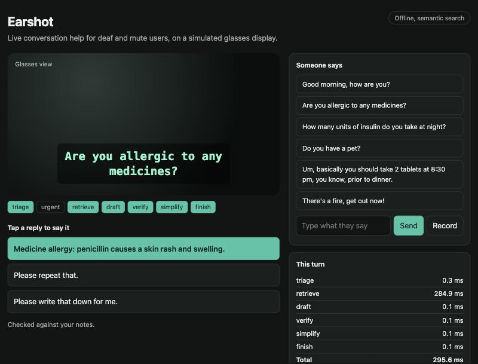
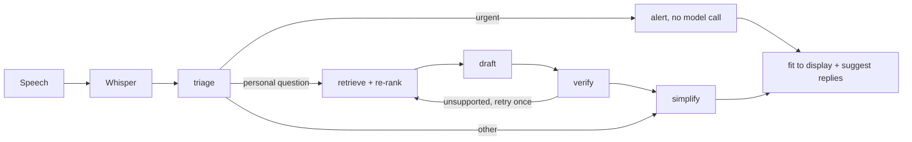

# Earshot

**A live conversation assistant for deaf and mute users, built for a small glasses display.** It turns speech into short plain-English captions, finds the answer to personal questions in the user's own notes, and suggests a reply they can tap to speak. If the notes don't contain the answer, it says so instead of guessing.



Built with **Python, LangGraph, LangChain, FastAPI, FAISS, Hugging Face models, faster-whisper and Docker**.

## Example

A doctor asks, *"Are you allergic to any medicines?"*

1. Speech becomes text, and the text is simplified into a caption.
2. The caption is fitted to the display: 32 columns, 2 rows, timed pages.
3. The agent sees a personal question and searches the user's notes.
4. A reply is drafted from the notes and checked against them.
5. The user taps the reply and it is spoken aloud.

Asked *"Do you have a pet?"* with nothing in the notes, it offers *"I'm not sure. Let me check and tell you."*

## How it works



| Decision | Why |
|---|---|
| Urgent speech uses rules, not a model | An alert must not depend on a network call |
| Replies are checked by code after drafting | Every number must appear in the cited notes, so a changed dose is rejected |
| Display fitting is plain code | A model can't overflow the display |
| Nothing is spoken without a tap | The user stays in control of what is said for them |
| Every model call has an offline fallback | A failed request degrades the caption, it doesn't lose it |
| Each user has a separate index | One user's notes can't appear in another's results |

## Evaluation

All data is synthetic: 83 questions across 2 personas, split into dev and test. Abstention thresholds are chosen on dev and reported on test (41 questions). Full results are in [evals/results/latest.md](evals/results/latest.md).

**Whole agent, offline brain:**

| Metric | Baseline (hashing, lexical) | Semantic (MiniLM, cross-encoder) |
|---|---|---|
| Wrong facts offered | 19.5% | **0%** |
| Abstained when the notes had no answer | 66.7% | **100%** |
| Answerable questions answered correctly | 65.5% | 58.6% |
| p95 latency per turn | 2.7 ms | 46 ms |

The semantic setup is more cautious: it gave no wrong facts but abstained on 12 of the 29 answerable questions. For medical facts that is the better trade-off, though answering more of them is the clearest next improvement.

**Retrieval (29 test questions):**

| Embedder | Chunking | Re-ranker | Recall@1 | Recall@3 | MRR |
|---|---|---|---|---|---|
| hashing | sentence | none | 0.690 | 0.759 | 0.743 |
| MiniLM | sentence | none | 0.862 | 0.966 | 0.914 |
| MiniLM | sentence | lexical | 0.897 | 0.966 | 0.929 |
| MiniLM | sentence | cross-encoder | 0.862 | 0.966 | 0.915 |
| MiniLM | fixed | none | 0.966 | 1.000 | 0.977 |

- Real embeddings mattered most. The cross-encoder did not improve recall on this set.
- Fixed chunks score higher partly because a larger chunk contains the answer more easily. Sentence chunks give a cleaner reply to speak.

**Other measurements:**

| Check | Result |
|---|---|
| Speech (`tiny.en`) | 7.4% word error rate, about 530 ms per sentence, on 20 clean synthetic clips |
| Urgent speech, standard set | 8 of 8 flagged, no tokens used |
| Intent rules, standard set | 44 of 44 correct |
| Intent rules, harder set not used for tuning | **26.7% correct**, including 0 of 3 urgent phrases |
| Captions keeping numbers and names | 6 of 6 |

## Known limits

- **Not yet measured with a real LLM.** The tests use a fake model, so the numbers above are for the offline brain. LLM quality, latency and cost need an API key: set it and run `python -m evals.run --out llm`.
- **The offline rules are weak on unusual wording.** The harder intent set shows this, and it is the main reason to use the LLM. Urgent detection is keyword-based and missed "You're bleeding!".
- **The datasets are small and synthetic.** Differences of a question or two aren't meaningful. Real use needs testing with deaf and mute users.
- **Speech was tested on clean synthetic audio.** Real rooms, accents and Indian English will be harder. Browser recording has not been tested with a real microphone.
- **The default baseline search can suggest wrong facts.** It exists for quick setup and as a comparison, and the demo labels it. Use `minilm` and `cross-encoder` for anything else.
- **Notes live in memory** and are lost on restart.
- **Privacy:** with an LLM key set, transcripts and matching notes go to that provider. Medical data needs a local model or proper data agreements.
- On macOS, `earshot/__init__.py` works around a PyTorch and FAISS OpenMP conflict by running with one thread.

## Run it

```bash
python3.11 -m venv .venv
source .venv/bin/activate
pip install -r requirements-ml.txt -r requirements-dev.txt
cp .env.example .env
```

In `.env`, set `EARSHOT_EMBEDDER=minilm` and `EARSHOT_RERANKER=cross-encoder`. Then:

```bash
uvicorn earshot.api:app --port 8123
```

Open http://localhost:8123. Add `EARSHOT_LLM_API_KEY` for generated replies, and set the model and prices from your provider's current pages.

```bash
pytest -q
python -m evals.run
docker build -t earshot .
```

## API

| Method | Path | Purpose |
|---|---|---|
| `POST` | `/v1/turns` | Process one utterance |
| `WS` | `/v1/stream` | Same, streaming each agent step |
| `POST` | `/v1/transcribe` | Speech to text |
| `POST` | `/v1/users/{id}/notes` | Add notes |
| `GET` | `/v1/metrics` | p50/p95 latency by step, tokens, cost |
| `GET` | `/health` | Current configuration |
